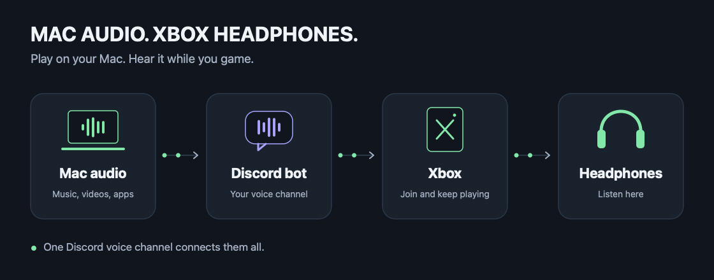

# Discord Mic

Play Mac audio through your Xbox using a Discord voice channel.



## Install

Requires macOS and [Homebrew](https://brew.sh).

```sh
brew install uv ffmpeg opus blackhole-2ch
git clone https://github.com/kmad/discord-mic.git
cd discord-mic
uv sync
```

## Set up Discord

1. Create an application in the [Discord Developer Portal](https://discord.com/developers/applications).
2. Open **Bot → Reset Token** and copy the bot token.
3. Open **OAuth2 → URL Generator**. Select **bot** and the permissions **View Channels**, **Connect**, and **Speak**.
4. Open the generated link and add the bot to your server.
5. Save the token locally:

   ```sh
   uv run relay.py --configure
   ```

   Paste the token at the hidden prompt. Leave the channel ID blank for now.

6. Find your voice channel ID:

   ```sh
   uv run relay.py --channels
   ```

7. Set `DISCORD_VOICE_CHANNEL_ID` in `.env` to that ID.

Keep `.env` private. It contains your bot token and is excluded from Git.

## Test on Xbox

Link your Discord and Xbox accounts. On Xbox, open **Parties & chats → Discord** and join your server's voice channel.

```sh
uv run relay.py --tone
```

You should hear a tone for 30 seconds. For headphones connected to speakers over HDMI, set Xbox chat output to **Speakers** or **Headset & speakers**, if available.

## Send live Mac audio

In **System Settings → Sound → Output**, select **BlackHole 2ch**. Then run:

```sh
uv run relay.py --device 'BlackHole 2ch'
```

Allow microphone access for your terminal if macOS asks. Play music, a browser video, or another app on your Mac. Everyone in the voice channel can hear the audio, including notifications.

Press **Ctrl+C** to stop. Select your normal Mac sound output when finished.

## Other commands

```sh
uv run relay.py --file /path/to/music.mp3
uv run relay.py --list-devices
uv run relay.py --tone --seconds 120
```

Use `--channel ID` to override the saved channel. Use `--volume 0.3` to lower the volume; the default is `0.5`.

## No sound?

- Check the bot's mute status and volume in Discord.
- Test the same channel on your Mac to check Xbox audio routing.
- If encryption reports `ready=False`, run `uv sync`. Keep the dependency pins: discord.py 2.7.1 needs davey below 0.2. See the [upstream fix](https://github.com/Rapptz/discord.py/pull/10548).
- If BlackHole is missing, restart the Mac after installation.

Keep the Mac awake while streaming. Discord adds delay and compression. Direct phone audio capture is not included. Xbox Party Chat cannot stay active alongside Discord voice.
